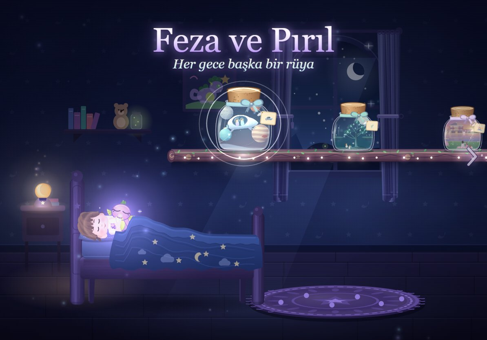
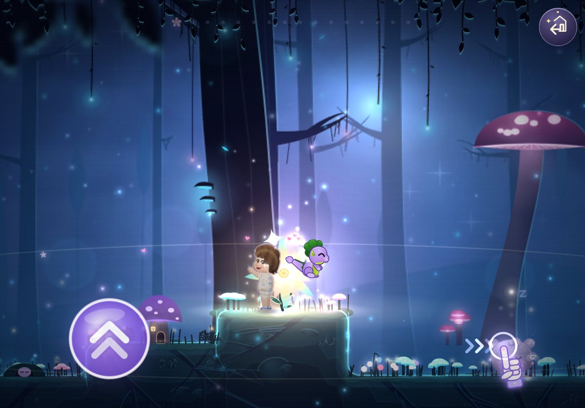
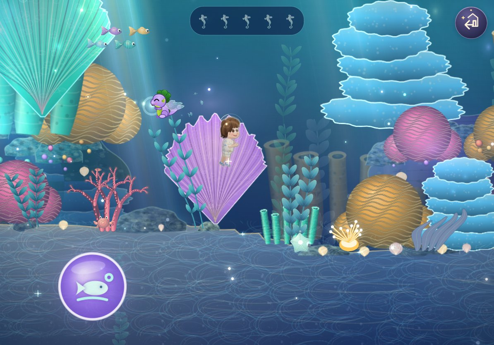
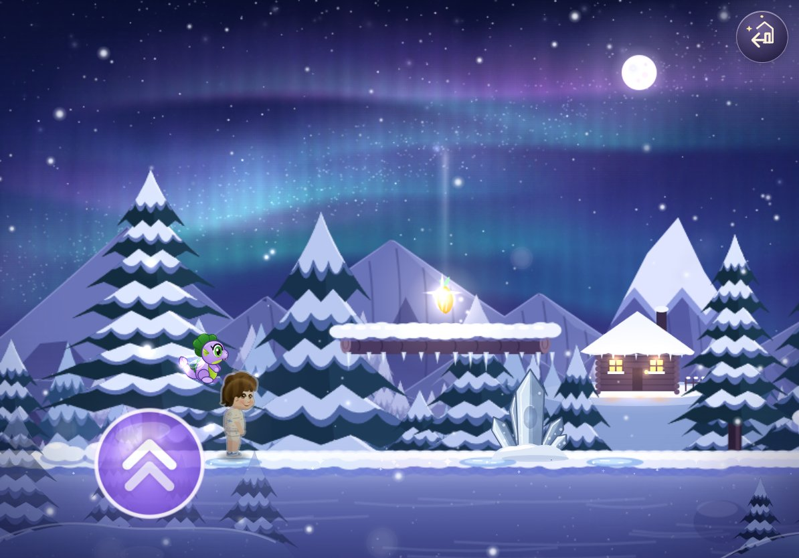
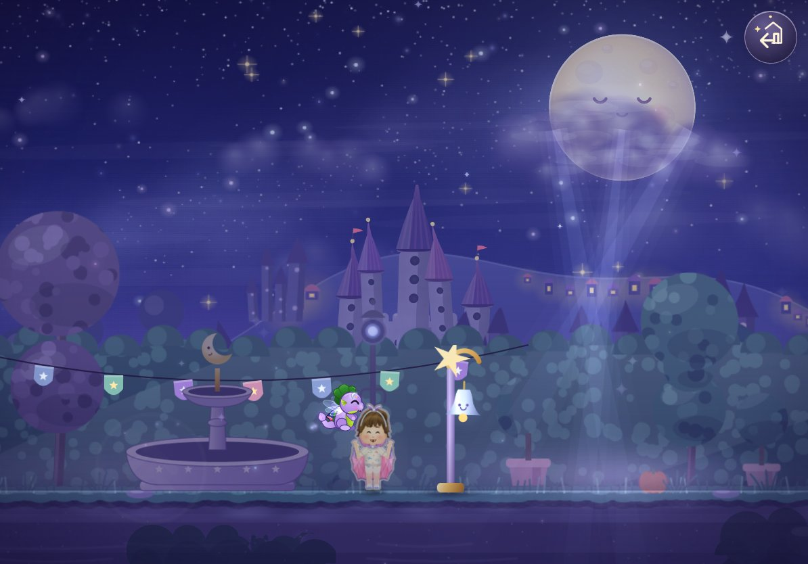
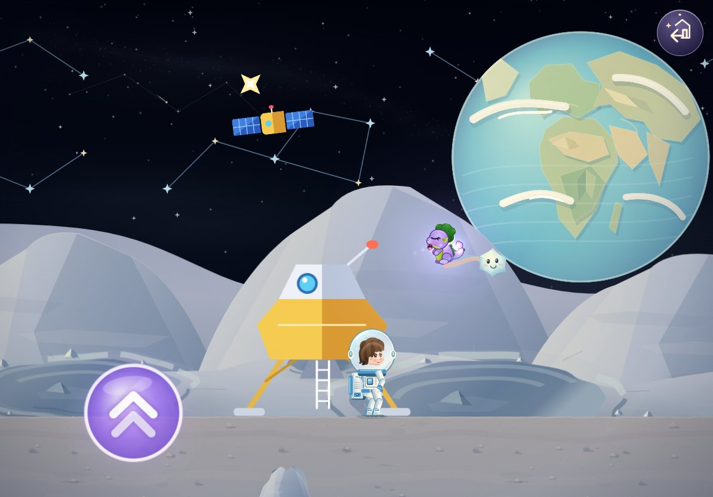

# Feza ve Pırıl: Işıklı Rüyalar ✨🐉

5 yaşındaki Feza için yapılmış, Ori havasında (biraz da Gris) iki boyutlu, büyülü bir platform macerası.
Feza, uyku arkadaşı peluş ejderha Pırıl'a sarılıp uyur. **Her gece başka bir rüya:** raftaki rüya kavanozlarından birine dokunur ve o rüyaya gider.
Her rüya sabah Feza'nın yatağında uyanmasıyla biter; bitirilen rüyaya altın yıldız gelir.
Korkutucu hiçbir şey, kaybetmek yoktur. Feza okuma bilmediği için her şey Pırıl'ın sesiyle ve ışıklı ipuçlarıyla anlatılır.

**Oyna:** https://goktugkarpat.github.io/feza-piril-2d-platformer/

## Rüyalar

1. **Işık Ormanı** — Işık çiçeklerini açıp tüylü Pofudukları uyandırırlar, ışık şarkısını söyleyip Işık Ağacı'nı yeniden parlatırlar.
2. **Yıldız Gölü** — Göle düşen yıldızlar uyandırılır, göğe dönüp takımyıldızını çizer.
3. **Bulut Ülkesi** — Renksiz Bulut Kuzucuklarına sarılıp gökkuşağını geri getirirler; zıplatan bulutlar ve Pırıl'ın sırtında uçuş.
4. **İnci Denizi** — Su altında her yöne yüzülür: denizatları, ışıklı mercanlar, sevimli ahtapot ve vatozun sırtında yolculuk.

| | |
|---|---|
|  |  |

5. **Uyuyan Yanardağ** — Işık bahçeleri canlanır, Anka yumurtası okşanarak uyanır, lav nehrinde kayıkla güvenli bir yolculuk yapılır.
6. **Şenlik Kalesi** — Fenerler yakılır, midilliler uyandırılır, midilli sırtında halka kapılır, kale avlusunda şenlik olur.
7. **Kuzey Işıkları** — Kar fenerleri, kardan adam, buzlu gölde kayma ve ren geyiğinin çektiği kızakla yolculuk.
8. **Balkabağı Gecesi** — Kostüm seçme, kabak fenerleri, saklanan sevimli hayaletçikler, "Şeker mi şaka mı!" ve süpürgeyle uçuş.
9. **Pırıl'ın Ejderha Vadisi** — Pırıl, Feza'yı evine götürür: ejderha yavruları, kuzen Fıstık'ın uçma dersi ve Büyükanne'nin sırtında uçuş.
10. **Ay Işığı Şatosu** — Sevimli Vela ve ailesiyle şatonun ay ışığı aynalarla geri getirilir; sonunda Ay Balosu.

| | |
|---|---|
|  |  |

11. **Annemle Sabancı'da Bir Gün** — Feza, annesi ve Pırıl kampüste sabahtan gün batımına gezer: scooter, uçurtma, fıskiyeler,
    kaplumbağalar, gölette kayık ve tepede piknik.
12. **İpek Göğü** — Feza, annesi ve Pırıl ay ışıklı gök bahçelerinde ışık köklerini büyütür, bulutlarda zıplar, yaşayan bir yaprakla uçar.
13. **Annemle Yıldız Yolculuğu** — Feza ile annesi Ay, Mars, Jüpiter ve Uranüs'ü keşfeder; yolculuk Feza'nın yatağına dönüşle biter.

**Pofuduklar**, ormanın ışığını karınlarında taşıyan tüylü dostlardır. Üstlerine zıplayınca hapşırıp uyanırlar ve Feza'nın peşine takılırlar.

## Nasıl açılır

- **İnternette:** https://goktugkarpat.github.io/feza-piril-2d-platformer/
- **iPad'de uygulama gibi:**
  1. iPad'de **Safari**'yi aç ve yukarıdaki adrese git.
  2. Üstteki **Paylaş** düğmesine dokun (kutudan çıkan ok).
  3. Listeden **Ana Ekrana Ekle**'yi seç, sonra **Ekle**'ye dokun.
  4. Ana ekranda oyunun simgesi belirir; ona dokununca oyun tam ekran açılır.
  5. İlk açılışta internet gerekir; sonra internetsiz de açılabilir. iPad'de internetsiz kullanım henüz denenmedi.
- **Bilgisayarda:** oyun klasöründe `python -m http.server 8000` çalıştırıp tarayıcıda http://localhost:8000/ adresini aç.
  `index.html` dosyasına çift tıklayınca da Chrome'da açılır (internetsiz kopya bu yolla kurulmaz).

## Nasıl oynanır

- **Yürümek:** ekranın herhangi bir yerine parmağını koyup tut; Feza o tarafa yürür. Parmak uzaktaysa koşar.
- **Zıplamak:** sol alttaki büyük yuvarlak düğmeye bas. Havadayken bir daha basınca Pırıl Feza'yı yukarı iter.
- **Dokunmak:** ışık çiçeklerine, hayvanlara ve parlayan şeylere dokununca açılırlar, renklenirler ya da oyun başlar.
- **Pofuduklar:** uyuyan Pofuduğun üstüne zıpla; uyanır ve Feza'nın peşine takılır.
- **Takılırsa:** Pırıl yolu gösterir, gerekirse Feza'yı taşır. Kaybetmek yoktur.
- **Rüyalara dönüş:** sağ üstteki ev simgesine basılı tut. Kısa dokunmak çıkış yapmaz.
- **Klavye (ebeveyn için):** oklar / A–D yürür, Boşluk / W / ↑ zıplar.

## Ebeveyn için notlar

- **Sessiz açmak:** adresin sonuna `?sessiz` ekle. Altyazı için `?altyazi`.
- **Doğrudan bir rüya açmak:** `?bolum=1` … `?bolum=9` veya `?bolum=11` … `?bolum=14`. Açılışı da atlamak için `?sessiz&atla&bolum=5`.
- **Kayıtları sıfırlamak:** rüya seçim ekranında sol üst köşeye 3 saniye basılı tut.
- Bütün rüyalar baştan açıktır, kilit yoktur. Bitirilen rüyalar cihazda saklanır.
- **Ses:** anlatım doğal bir Türkçe kadın sesiyle önceden kaydedildi.
- **GitHub'a göndermek:** klasördeki `yayinla.command` dosyasına çift tıkla.

## Yapım

Bu oyun, Feza'nın babası **Göktuğ Karpat** (@goktugkarpat) ile yapay zekâ yardımcıları **Claude Code** (Anthropic), **Codex** (OpenAI) ve **Antigravity** (Google) birlikte çalışarak yapılmıştır.
Tasarım ve kararlar ailenindir; kod, çizim ve seslendirme düzenlemeleri bu yardımcılarla birlikte yazılmıştır.
Oyun yalnızca Feza için, kâr amacı olmadan yapılmış bir aile projesidir.
